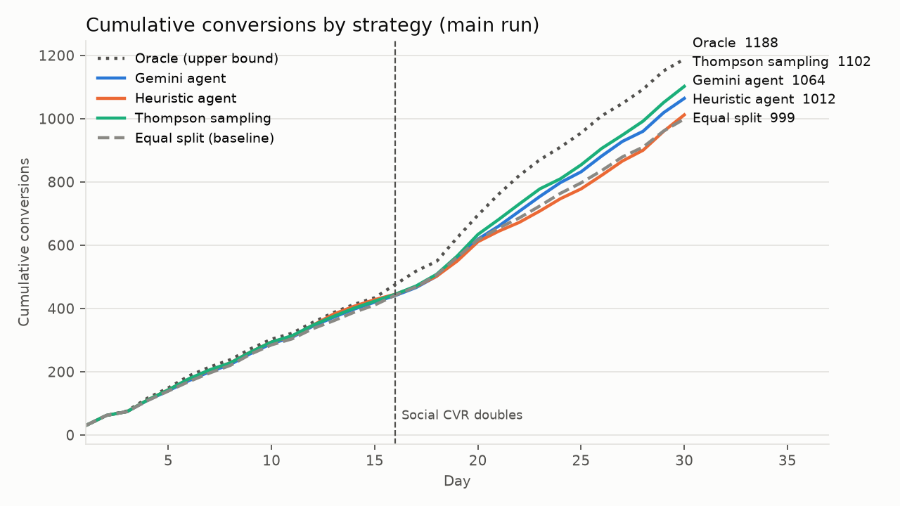
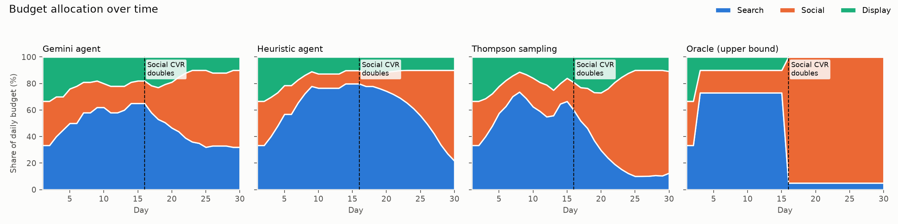

# Agentic AI in Marketing

[](#)
[](https://www.python.org/)
[](https://ai.google.dev/)
[](https://langchain-ai.github.io/langgraph/)
[](notebook.ipynb)
[](tests/)

Agentic AI projects for **BUS4 118S: Agentic AI in Marketing**, both powered by Google Gemini.

| Project | What it does | Docs |
|---|---|---|
| **Ad Optimization Agent** | Splits a daily ad budget across Search, Social and Display to maximize conversions, with guardrails enforced in code | This page |
| **Customer Service Chatbot** | A LangGraph multi-agent assistant for order status, refunds and product recommendations, with `MemorySaver` conversation memory | [`chatbot/README.md`](chatbot/README.md) |

## Contents

- [Ad Optimization Agent](#ad-optimization-agent)
  - [Deliverables](#deliverables)
  - [Getting started](#getting-started)
  - [How it works](#how-it-works)
  - [Assumptions](#assumptions)
  - [Results](#results)
  - [Key findings](#key-findings)
- [Customer Service Chatbot](#customer-service-chatbot)
- [Repository layout](#repository-layout)

---

## Ad Optimization Agent

An agent that splits a daily ad budget across **Search, Social and Display** to maximize conversions. It
reads channel performance from a CSV, proposes tomorrow's budget, enforces guardrails in code, and logs a
one-sentence rationale for every decision. Decisions come from **Gemini** (with a system prompt), and a
transparent rule-based agent takes over whenever the LLM isn't available.

### Deliverables

| Deliverable | Location |
|---|---|
| Design doc (≤1 page) | [`docs/design_doc.md`](docs/design_doc.md) |
| System prompt | [`prompts/system_prompt.md`](prompts/system_prompt.md) |
| Working script / notebook | [`propose.py`](propose.py), [`evaluate.py`](evaluate.py), [`notebook.ipynb`](notebook.ipynb) |
| Results and decision logs | [`outputs/`](outputs/) |
| Scaling note (≤½ page) | [`docs/scaling_note.md`](docs/scaling_note.md) |

### Getting started

**Prerequisites:** Python 3.10+ and, optionally, a free [Google AI Studio](https://aistudio.google.com/) API key.

```bash
python -m venv .venv
# Windows: .venv\Scripts\activate     macOS/Linux: source .venv/bin/activate
pip install -r requirements.txt
```

| Command | Purpose |
|---|---|
| `python generate_data.py` | Writes `data/ad_performance.csv` (30 days × 3 channels) |
| `python propose.py` | Reads the CSV and proposes tomorrow's budget with a rationale |
| `python evaluate.py --gemini-seeds 3` | Compares all strategies and writes `outputs/` (~30 s; Gemini replays from cache) |
| `pytest` | Runs the test suite |
| `jupyter notebook notebook.ipynb` | Walks through the same pipeline step by step |

`propose.py --policy heuristic|thompson|gemini|equal_split --budget 1500 --csv path.csv` works on any CSV
with the same columns.

> [!NOTE]
> **The Gemini key is optional.** Copy `.env.example` to `.env` and set `GEMINI_API_KEY`. Without a key,
> Gemini decisions fall back to the heuristic and the `source` column in the logs says so. Gemini replies
> are cached in `outputs/gemini_cache.json`, so anyone can re-run the evaluation and get identical results
> without a key or any API cost.

### How it works

```
read_performance ─► compute_metrics ─► policy proposes split ─► apply_guardrails ─► check_rationale ─► log_decision
     (CSV)            (CTR, CVR, CPA,      (Gemini / heuristic /      (±20%/day, 10% floor,   (no personal data,   (outputs/*.csv)
                       conv per $100)       Thompson)                   total = budget)         neutral tone)
```

| Strategy | Description |
|---|---|
| **Heuristic agent** | Ranks channels by recency-weighted conversions per $100. If the leader is at least 10% ahead, it shifts 10–20% more budget its way, taken from the laggards; otherwise it holds. |
| **Gemini agent** | Gets the same metrics plus the system prompt and returns `{allocation, rationale, confidence}` as JSON. Code clips anything outside the guardrails and logs the clip. |
| **Thompson sampling** | A standard explore/exploit algorithm, used as a stronger comparison. |
| **Oracle** | Knows the simulator's true rates. An upper bound for measuring regret, not a real strategy. |

### Assumptions

- **Mock data from a simulator.** A plain CSV can't say what would have happened under a different budget,
  so `adagent/simulator.py` gives each channel hidden true rates (CPC, CTR, CVR) with diminishing returns
  and daily noise. `data/ad_performance.csv` is what an equal split produced in that market.
- **A mid-campaign change.** Social's conversion rate doubles on day 16 (think: a new creative). Search is
  best before that and Social after, so the agent has to notice and adapt.
- **Fair comparison.** Every strategy sees identical market noise (common random numbers). Results are
  averaged over 20 market seeds as well as the main run.
- **Setup.** $1,000/day, 30 days, 2 warm-up days at an equal split. Conversions are counted on the day of
  spend (no attribution lag).
- **No exploration by default.** Random exploration (boosting a random non-leader 10% of the time) cost
  about 2% of conversions in testing, because the 10% floor already keeps every channel learning. It
  remains available as `EXPLORE_RATE` in `adagent/config.py`.

### Results

Main run (seed 42, 30 days, $30,000 total spend). Full tables are in [`outputs/results.md`](outputs/results.md).

| Strategy | Conversions | vs. equal split | Avg CPA | Budget to best channel |
|---|---:|---:|---:|---:|
| Oracle (upper bound) | 1188 | +18.9% | $25.25 | 81% |
| Thompson sampling | 1102 | +10.3% | $27.22 | 58% |
| Gemini agent (`gemini-3.5-flash-lite`) | 1064 | +6.5% | $28.20 | 49% |
| Heuristic agent | 1012 | +1.3% | $29.64 | 47% |
| Equal split (baseline) | 999 | — | $30.03 | 33% |

Gemini made all 28 post-warm-up decisions itself (0 fallbacks); its replies are cached in
`outputs/gemini_cache.json`, so `python evaluate.py --gemini-seeds 3` reproduces these numbers with no key.

- **Same 3 markets, like-for-like:** Gemini **+5.8%**, heuristic +4.4%, Thompson +8.0%, oracle +19.0% vs. equal split.
- **Across 20 markets** (no Gemini, to stay within free-tier limits): heuristic **+4.8%**, Thompson **+9.3%**,
  oracle +18.7%. Every learning strategy also lowers the average CPA.




### Key findings

- **Learning beats a static split**, mainly by moving money out of Display (the highest CPA).
- **Scoring on a 3-day window chased noise** and barely beat the equal split. Recency-weighted scoring, plus a
  "hold unless the lead is ≥10%" rule, fixed most of that.
- **The guardrails have a real cost.** A channel pushed down to the 10% floor can only grow 20% a day, so after
  Social improves on day 16 the agent needs about a week to move real budget there. That accounts for most
  of the gap to the oracle. It's a deliberate trade: stability and safety over speed.
- **Gemini beat the heuristic** by keeping more money in Social early on (15–20% vs. the 10% floor), so it moved
  into Social sooner after day 16, and its rationales cite the right numbers. But it stayed cautious: it kept
  about a third of the budget in Search even when Social's CPA was half of Search's, which is why Thompson
  sampling still did better. The guardrails clipped 7 of its 28 proposals, each a move bigger than ±20% in a day.
- **Free-tier limits matter.** `gemini-3.6-flash` allows only 20 requests a day, less than one 30-day run, so the
  default is `gemini-3.5-flash-lite`. On a daily-quota error the agent stops calling and logs why, and the
  heuristic covers the remaining days.

---

## Customer Service Chatbot

"Ridge" is the customer assistant for Ridgeline Coffee Co., built with **LangGraph** and **Gemini**. A
router sends each message to an **Order Status**, **Refunds & Returns**, or **Product Recommendation**
agent, each with its own tools, and `MemorySaver` keeps the conversation across turns.

[](https://colab.research.google.com/github/Shacxify/BUS4118S---Agentic-AI-in-Marketing/blob/ad-optimization-agent/chatbot/chatbot_demo.ipynb)

Run it in your browser with the button above (add `GEMINI_API_KEY` under Colab's 🔑 Secrets first), or locally:

```powershell
.\.venv\Scripts\python.exe -m chatbot.chat     # interactive chat (order numbers RC-1001 to RC-1004)
.\.venv\Scripts\python.exe -m chatbot.demo     # scripted demo -> chatbot/outputs/demo_transcript.md
```

Architecture, requirement mapping and the demo transcript are in [`chatbot/README.md`](chatbot/README.md).

---

## Repository layout

```
adagent/            Ad agent: config, simulator, tools, guardrails, policies, Gemini client, agent loop
chatbot/            Customer service chatbot: graph, agents, tools, prompts, mock data, demo outputs
prompts/            Ad agent system prompt
data/               ad_performance.csv
outputs/            Ad agent results: decision logs, results.md, summary.json, charts, Gemini cache
docs/               design_doc.md, scaling_note.md
tests/              Guardrail and chatbot tests
scripts/            build_notebook.py
generate_data.py    propose.py    evaluate.py    notebook.ipynb
```
