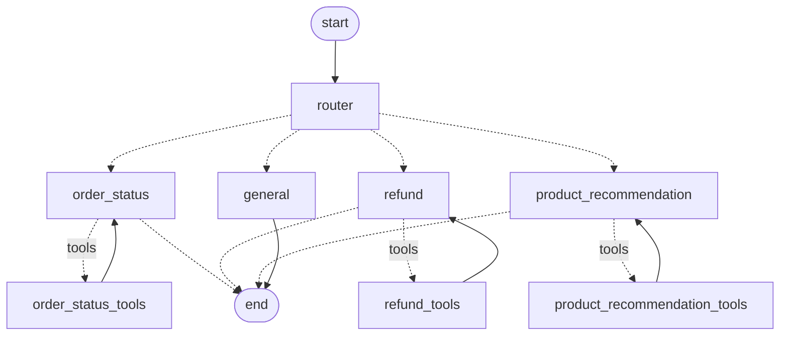

# Ridgeline Coffee Co. Customer Assistant (Agentic AI Chatbot)

[](https://colab.research.google.com/github/Shacxify/BUS4118S---Agentic-AI-in-Marketing/blob/ad-optimization-agent/chatbot/chatbot_demo.ipynb)
[](../README.md)
[](https://www.python.org/)
[](https://langchain-ai.github.io/langgraph/)
[](https://ai.google.dev/)
[](graph.py)
[](../tests/test_chatbot.py)

A multi-agent customer service and sales chatbot built with **LangGraph** and **Google Gemini**. "Ridge"
helps customers of Ridgeline Coffee Co., a fictional direct-to-consumer coffee roaster (the same kind of
brand whose Search/Social/Display budget the [Ad Optimization Agent](../README.md) manages), check orders,
get refunds, and find coffee to try next.

| Requirement | How it's met | Where |
|---|---|---|
| System prompt defining the chatbot's role | "Ridge" persona: role, tone, privacy rules, "use tools, never invent facts" | [`prompts.py`](prompts.py) |
| 3+ inquiry types handled by different agents | A router sends each message to the **Order Status**, **Refunds & Returns**, or **Product Recommendation** agent (plus a general agent for greetings and recaps). Each agent has its own prompt and its own tools. | [`graph.py`](graph.py), [`tools.py`](tools.py) |
| Conversation state for 3+ turns with `MemorySaver` | The graph is compiled with a `MemorySaver` checkpointer; every conversation is saved under its own `thread_id` | [`graph.py`](graph.py) |
| OpenAI or Google AI API | Gemini (`gemini-3.5-flash-lite` by default) through `langchain-google-genai` | [`llm.py`](llm.py) |

## How it works



1. **Router.** Gemini reads the recent conversation and picks the agent for the latest message, so a
   follow-up like "can I get my money back?" goes to the refund agent. If classification fails, a keyword
   router takes over.
2. **Specialist agents.** Each one is a Gemini call with the shared brand prompt, its own role prompt,
   and only its own tools. It loops agent → tools → agent until it can answer.

   | Agent | Tools |
   |---|---|
   | Order Status | `lookup_order` |
   | Refunds & Returns | `get_refund_policy`, `check_refund_eligibility`, `start_return` (only after the customer confirms) |
   | Product Recommendation | `search_products` (roast, flavor, brew method, decaf, budget) |
   | General | none |

3. **Memory.** `MemorySaver` stores the whole message history per `thread_id`. Agents see earlier turns
   as plain text, so the refund agent knows which order the customer just looked up, and the product
   agent knows which roast they didn't like. A new `thread_id` starts with no memory.

Store data (4 orders, 9 coffees, refund policy) is mock data in [`data.py`](data.py). "Today" is fixed at
Oct 26, 2026, so refund-window results are the same every run.

## Run it

### In Google Colab (no setup)

[](https://colab.research.google.com/github/Shacxify/BUS4118S---Agentic-AI-in-Marketing/blob/ad-optimization-agent/chatbot/chatbot_demo.ipynb)

1. Click the button to open [`chatbot_demo.ipynb`](chatbot_demo.ipynb) in Colab.
2. Click the 🔑 **Secrets** icon in the left sidebar, add `GEMINI_API_KEY` with your
   [Google AI Studio key](https://aistudio.google.com/apikey), and turn on **Notebook access**.
3. Choose **Runtime → Run all**. The notebook clones this repo, installs the dependencies, runs the
   five-turn demo, shows what `MemorySaver` stored, and ends with an interactive chat.

### Locally

From the project root, using the project's virtual environment (Python 3.10+):

```powershell
python -m venv .venv
.\.venv\Scripts\python.exe -m pip install -r requirements.txt
copy .env.example .env        # then put your Google AI Studio key in GEMINI_API_KEY

.\.venv\Scripts\python.exe -m chatbot.chat     # chat interactively (order numbers RC-1001 to RC-1004)
.\.venv\Scripts\python.exe -m chatbot.demo     # scripted demo -> chatbot/outputs/demo_transcript.md
.\.venv\Scripts\python.exe -m pytest           # offline tests, no API key needed
```

On macOS/Linux use `.venv/bin/python` instead of `.\.venv\Scripts\python.exe`.

## Results

Full output: [`outputs/demo_transcript.md`](outputs/demo_transcript.md) (live Gemini run).

| Turn | Customer | Agent → tools | Shows |
|---|---|---|---|
| 1 | "Can you check on my order RC-1001?" | order_status → `lookup_order` | Correct items, tracking, delivery date |
| 2 | "I opened one of the Sumatra bags... too earthy. Can I get my money back?" | refund → `check_refund_eligibility` | Taste Guarantee applies; asks before acting |
| 3 | "Yes please, go ahead and start that for the Sumatra." | refund → `start_return` | Return **RMA-1001-01** created; order number not repeated |
| 4 | "What should I try instead? ...pour-over, fruity, under $20." | product_recommendation → `search_products` | Recommends Colombia Huila ($18), contrasts it with the Sumatra |
| 5 | "What was my order number, and what's my return ID?" | general | Recalls RC-1001 and RMA-1001-01 from memory, 20 messages saved |
| New thread | "What's my order number?" | order_status | No memory carries over between conversations; asks for the number |

## Limitations

- Mock data and an in-memory store: returns and conversation memory reset when the program exits. A
  production version would use a database and a persistent checkpointer (e.g. `SqliteSaver`).
- No identity check: anyone with an order number can look it up.
- Free-tier Gemini limits requests per minute; the demo pauses between turns and retries rate-limit errors.
