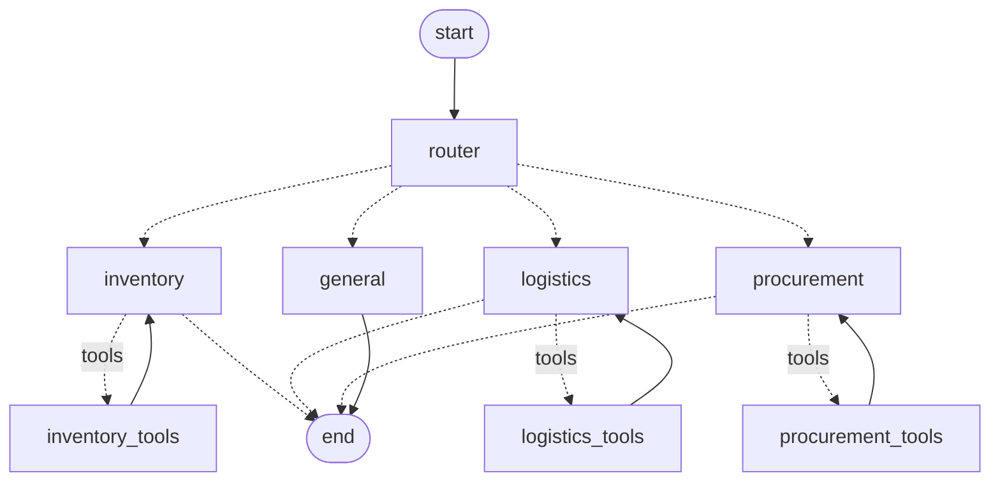

# Ridgeline Coffee Co. Supply Chain Assistant (Agentic AI in Supply Chain)

[](https://colab.research.google.com/github/Shacxify/BUS4118S-AgenticAIinMarketing/blob/main/supplychain/supplychain_demo.ipynb)
[](../README.md)
[](https://www.python.org/)
[](https://langchain-ai.github.io/langgraph/)
[](https://ai.google.dev/)
[](graph.py)
[](../tests/test_supplychain.py)

A multi-agent supply chain assistant built with **LangGraph** and **Google Gemini**. "Atlas" helps the
operations team at Ridgeline Coffee Co., the same fictional roaster as the [Ad Optimization Agent](../README.md)
and the [customer service chatbot](../chatbot/README.md), keep green coffee and packaging in stock: it spots
low stock, forecasts stockouts, tracks inbound shipments, and buys from the right supplier.

| Requirement | How it's met | Where |
|---|---|---|
| System prompt defining the assistant's role | "Atlas" persona: supply chain analyst, tools-only facts, never orders without approval, answer-first tone | [`prompts.py`](prompts.py) |
| 3+ request types handled by different agents | A router sends each message to the **Inventory & Demand**, **Logistics**, or **Procurement** agent (plus a general agent for greetings and recaps). Each agent has its own prompt and its own tools. | [`graph.py`](graph.py), [`tools.py`](tools.py) |
| Conversation state for 3+ turns with `MemorySaver` | The graph is compiled with a `MemorySaver` checkpointer; every conversation is saved under its own `thread_id` | [`graph.py`](graph.py) |
| OpenAI or Google AI API | Gemini (`gemini-3.5-flash-lite` by default) through `langchain-google-genai` | [`../chatbot/llm.py`](../chatbot/llm.py) |

## How it works



1. **Router.** Gemini reads the recent conversation and picks the agent for the latest message, so a
   follow-up like "go with the fastest option" goes to procurement. If classification fails, a keyword
   router takes over. The router and conversation handling are shared with the customer service chatbot.
2. **Specialist agents.** Each one is a Gemini call with the shared Atlas prompt, its own role prompt,
   and only its own tools. It loops agent → tools → agent until it can answer.

   | Agent | Tools |
   |---|---|
   | Inventory & Demand | `check_inventory` (on hand, days of cover, reorder point), `forecast_stockout` (day-by-day projection with inbound POs and the +35% holiday uplift) |
   | Logistics | `track_shipment` (promised vs current ETA, delay reason), `list_inbound_shipments` |
   | Procurement | `compare_suppliers` (price, lead time, on-time rate, minimum order, arrives in time?), `create_purchase_order` (only after the user approves) |
   | General | none |

3. **Memory.** `MemorySaver` stores the whole message history per `thread_id`. Agents see earlier turns
   as plain text, so the logistics agent knows which shipment "that Brazil shipment" is, and procurement
   sizes the order from the shortfall the inventory agent found. A new `thread_id` starts with no memory.

Supply chain data (6 items, 11 supplier quotes, 4 inbound POs) is mock data in [`data.py`](data.py). "Today"
is fixed at Oct 26, 2026, so forecasts are the same every run.

## Run it

### In Google Colab (no setup)

1. Click the button at the top to open [`supplychain_demo.ipynb`](supplychain_demo.ipynb) in Colab.
2. Click the 🔑 **Secrets** icon in the left sidebar, add `GEMINI_API_KEY` with your
   [Google AI Studio key](https://aistudio.google.com/apikey), and turn on **Notebook access**.
3. Choose **Runtime → Run all**.

### Locally

From the project root, with the virtual environment and `.env` set up as in the [main README](../README.md):

```powershell
.\.venv\Scripts\python.exe -m supplychain.chat     # chat interactively
.\.venv\Scripts\python.exe -m supplychain.demo     # scripted demo -> supplychain/outputs/demo_transcript.md
.\.venv\Scripts\python.exe -m pytest               # offline tests, no API key needed
```

## Results

Full output: [`outputs/demo_transcript.md`](outputs/demo_transcript.md) (live Gemini run).

| Turn | Ops manager | Agent → tools | Shows |
|---|---|---|---|
| 1 | "How are we looking on Brazil Cerrado? Are we going to run out?" | inventory → `check_inventory`, `forecast_stockout` | 8.6 days of cover; stockout Nov 3, 6 days short, ~380 lb unmet |
| 2 | "That Brazil shipment, is it still on schedule?" | logistics → `track_shipment` | PO-2211 found from memory: 7 days late (Santos port congestion), ETA Nov 9 |
| 3 | "Who can get us enough Brazil to bridge the gap, and what will it cost?" | procurement → `compare_suppliers` | Sized to the 380 lb shortfall; Bay Area (Oct 29, $4.10/lb) vs Pacific ($3.85/lb, Nov 1) |
| 4 | "Go with the fastest option. Place an order for 500 lb." | procurement → `create_purchase_order` | **PO-2231** placed, $2,050, arrives Oct 29 |
| 5 | "Recap: the new PO number, when it lands, and when the delayed shipment arrives." | general | Recalls PO-2231 and PO-2211 from memory |
| New thread | "When does my PO arrive?" | logistics → `list_inbound_shipments` | No memory carries over: it can't tell which PO is "mine", so it lists all open POs |

After the bridge order, `forecast_stockout` for Brazil returns "no stockout in horizon".

## Limitations

- Mock data and an in-memory store: new POs and conversation memory reset when the program exits. A
  production version would read from the ERP/WMS and use a persistent checkpointer (e.g. `SqliteSaver`).
- Usage is a flat daily rate plus a holiday uplift, not a statistical forecast.
- No approval workflow beyond the user's chat confirmation; a real system would add spend limits and a
  second approver for large orders.
- Free-tier Gemini limits requests per minute; the demo pauses between turns.
